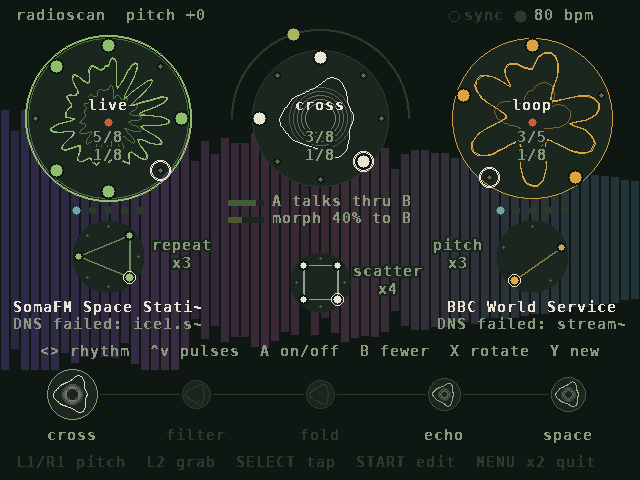
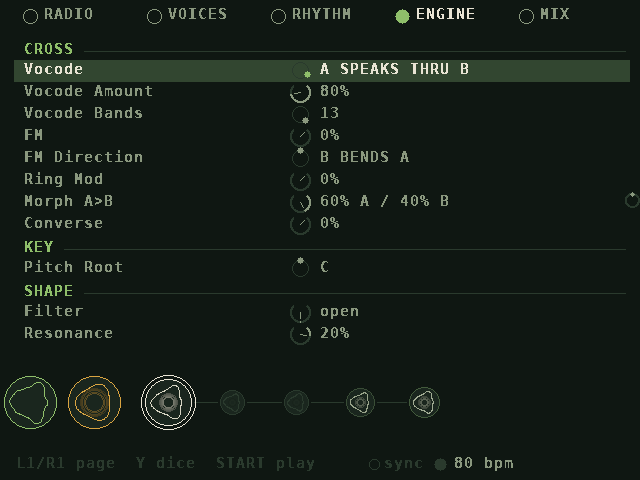
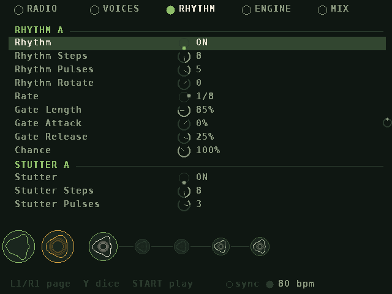
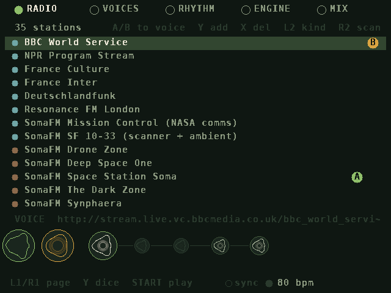
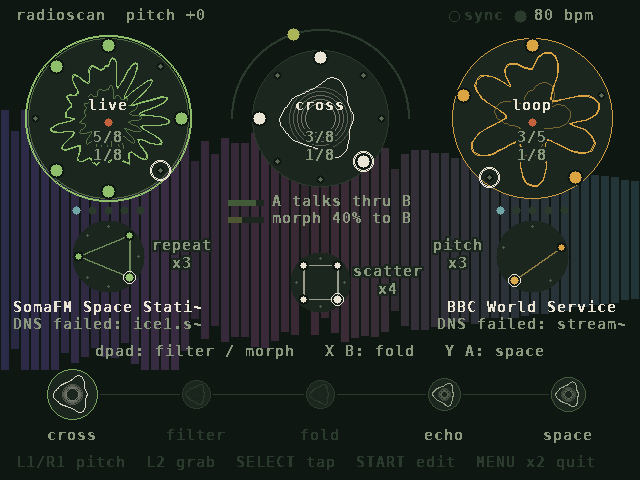
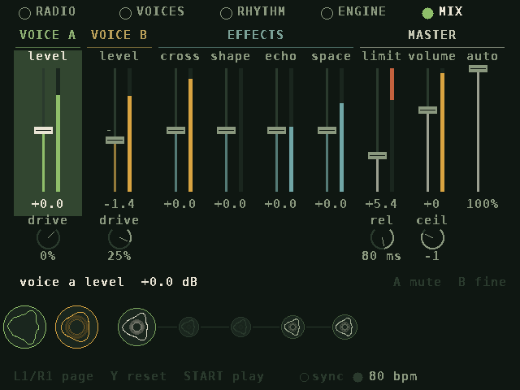
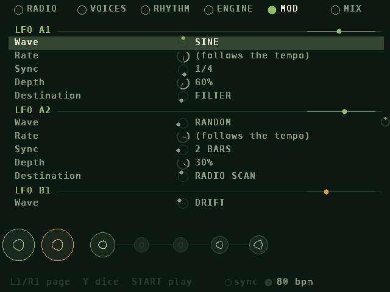
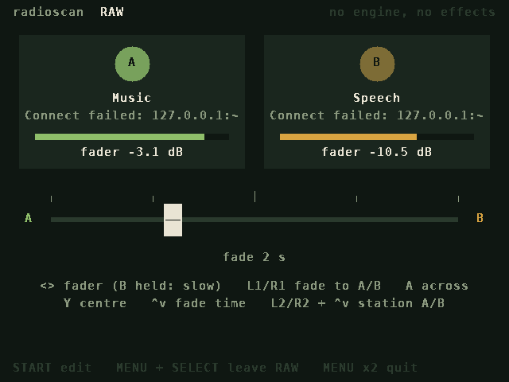

# RadioScan

A rhythm instrument for the **TrimUI Brick**, **Brick Hammer** and **Brick Pro** (TrimUI OS) played with **internet radio** (or your own
**.wav files**). Two stations become two voices. Each voice is opened and closed by its own Euclidean rhythm, the two can
cross-modulate each other (vocode, FM, ring mod, spectral morph), and the result runs through a filter,
a wavefolder, echo and space.



This is the TrimUI port of the Miyoo Mini Plus version ([Miyoo-RadioScan-dev](https://github.com/sydilaxe/Miyoo-RadioScan-dev)):
the same instrument and the same sound, on SDL2, with the 640x480 pages scaled 1.6x to fill the Brick's 1024x768
screen. What's new on the TrimUI: half the Miyoo's audio delay, a USB sound card or DAC takes over the output while
it's plugged in, and the Brick Pro's left stick works as a second d-pad. Settings and station lists from the Miyoo
load as they are.

## How it works

- **Two radio voices.** Each voice plays one station with one of four engines:
  - **LIVE:** the broadcast as it is (the default for voice A), with an optional sample-rate crush.
  - **LOOP:** a slice of the stream, replayed at the voice's pitch; every rhythm pulse restarts it (the default
    for voice B).
  - **WAVE:** a few milliseconds of the stream as a pitched waveform that keeps re-scanning the broadcast.
  - **GRAIN:** a cloud of grains from the last moments of the stream.

  LOOP, WAVE and GRAIN voices can play **forward**, in **reverse**, or **both** (a loop ping-pongs; grains go
  either way at random). Loops can be up to 2.7 seconds long.

  Each voice has its own **level**, **drive** and **pan**. **Focus** can make a voice listen only to speech or only to
  music; either voice can play any station. An optional **oscillator** (sine,
  triangle, saw or square) can be mixed into each voice for a cleaner tone or a carrier for cross-modulation.
  It's off by default; the radio comes first.
- **Two rhythms.** Each voice has a Euclidean rhythm that decides when it sounds: steps, pulses, rotate, rate
  and chance, and a gate shape (attack, length, release) from soft swells to sharp chops. With the rhythm off,
  the voice plays continuously. A third, **cross rhythm** brings the cross-modulation (morph, vocode, ring,
  FM) in on its pulses, with the same controls and gate shape; off, the cross stage stays on as set. All three
  rhythms are played directly on the PLAY page, as on hi5.
- **Stutter and glitch.** Each voice has a **stutter rhythm**, and so does the mix after cross-modulation and
  morph. On the steps it marks, the sound is chopped into 2 to 8 ratchets, in one of six modes:
  - **REPEAT:** the step's first slice, again and again.
  - **REVERSE:** every other ratchet backwards.
  - **RANDOM:** a random count, sometimes reversed.
  - **PITCH:** each ratchet higher (now and then lower), an octave over the step.
  - **DROPOUT:** some ratchets drop to silence.
  - **SCATTER:** latches a sample and plays fragments of it from anywhere, either way, at an octave down, as
    is, or up. Grabbing (tap L2) latches a new sample.

  A voice's stutter runs at its rate and opens the voice for the step; the cross stutter runs at the cross
  rhythm's rate. All work on any engine and turn on and off like the other rhythms. Tap tempo (SELECT) and Wi-Fi sync drive them all.
- **Cross-modulation.**
  - **Vocode:** A speaks through B, or B through A, with 5, 8, 13, 21 or 34 bands.
  - **FM:** one voice bends the other's pitch.
  - **Ring mod.**
  - **Morph:** blends the two voices' spectra from A toward B.
  - **Converse:** whichever voice is talking holds the floor and the other ducks. When the speaker pauses and
    the other station is talking, the floor passes over, so two broadcasts take turns like an overheard
    dialogue. It's made for two speech stations, but works on anything.
- **Sound.**
  - **Filter:** one knob from dark (low-pass) through open to thin (high-pass), plus resonance.
  - **Bass** and **treble** shelves.
  - **Drive** (warm saturation), **fold**, and **crush** (fewer bits, lower sample rate).
  - **Echo** (a dotted-eighth ping-pong), **space** (reverb) and **stereo width**.
  - **Mute** for each voice (L2 + B on PLAY, A on the MIX page); it fades rather than cuts.
  - **Volume**, a look-ahead **limiter** (push, release, ceiling), and a leveller (**auto level**) that keeps the
    overall loudness steady so the radio comes through clearly.
- **LFOs.** Each voice has two independent LFOs (MOD page): wave (sine, triangle, saw up, saw down, square,
  random, drift), rate (0.02 to 20 Hz, or **Sync** to a note value from 1/32 to 16 bars), depth and destination: the voice's pitch, level, pan, size, texture, drive
  or oscillator mix, or the shared filter, morph, fold, echo or space. Stepped waves glide a few ms so they don't
  click. They move the values the engine plays, never your settings, so turning one off puts everything back.
  A synced LFO takes its position from the clock the rhythms follow: tap tempo restarts it on the downbeat, Wi-Fi
  sync locks it to the lead unit, stopping the rhythms holds it, and its random and drift values come from the bar
  position, so synced units move together.
- **Radio scan.** An LFO sent to RADIO SCAN tunes its voice around the station list like a wave scanner: depth
  sets how far from the voice's own station it roams (a station or two either side at low depth, the whole list at
  full depth), the wave sets how (sine sweeps up and down the dial, random jumps), and the voice crossfades into
  each new station once it is playing (slower LFOs, longer fades, 0.3 to 4 s). A station that won't play is skipped.
  With scan off the voice glides back to its own station. The station name shows `~` while it is away.
- **Mix.** One page of faders with live meters: each voice's level and drive, how loud each effect comes back
  (cross, shape, echo, space), the limiter and the master volume.
- **RAW.** Hold MENU + SELECT for the two stations exactly as they arrive, through one crossfader and nothing else:
  no engine, no effects, no leveller, limiter or dither. With the fader at one end, that station comes out
  sample for sample as it was decoded. In between it's a plain linear crossfade, which can't add up louder than the
  louder station, so nothing clips. See [RAW](#raw) below.
- **Stations.** 35 are preloaded and you can add more three ways:
  1. Edit `stations.txt` on the SD card (`Name|URL|voice|music|sound`).
  2. Type a URL on the on-screen keyboard (RADIO page, **Y**).
  3. **Scan** the free [radio-browser.info](https://www.radio-browser.info) directory by genre, by name or at
     random, then audition results on either voice and save them (RADIO page, **R2**).

  HTTPS works through a built-in mbedTLS, along with ICY song titles, redirects and `.pls` / `.m3u` playlists.
- **WAV files.** A `.wav` file can stand in for a radio station on either voice. Copy files into the app's `wav`
  folder (`Apps/RadioScan/wav/`) and they join the station list the next time RadioScan starts, named after the file
  (kind: sound). Pick one on the RADIO page with A or B like any station; a voice can play a station and the other a
  file, or both files. A file plays looped and goes through the same engines, rhythms, cross-modulation and effects,
  and radio scan can land on it. Files elsewhere on the card can be listed in `stations.txt` as `file://wav/name.wav`
  (relative to the app folder) or `file:///mnt/SDCARD/path/name.wav` (absolute), or typed on the keyboard (Y).
  PCM 8/16/24/32-bit and 32/64-bit float at any sample rate, mono or stereo, are supported (compressed WAVs are not).
  The file is read from the card as it plays, so long files are fine.

## The screen

The PLAY page is for performing: the two rhythms and the sound, live.

- **Voice circles (left A, right B).** Each voice's waveform is wrapped around its circle like a polar
  oscilloscope, swinging out and in with the signal: faint and small inside for the raw broadcast, bright and wide
  outside for the voice as it sounds. Each is scaled to its own recent peak, so a quiet station still swings wide,
  and the outer one opens and closes with the voice's rhythm. Five dots underneath show how speech-like the
  station is.
- **Stutter rings.** Under each voice and under the centre, a stutter rhythm drawn geometrically: the pulses
  joined into a polygon that flashes when a step ratchets, with its mode and ratchet count beside it.
- **Rhythm rings.** Each voice wears its rhythm around its rim: coloured pulses, a white ring on the current step,
  and pulses/steps and the rate under the engine name. The cross rhythm circles the centre the same way.
- **Spectrum backdrop.** A soft frequency spectrum of the overall sound behind the circles. Its colour follows
  frequency, from indigo in the bass through rose in the mids to sky blue in the highs, hues kept apart from the
  voices' green and amber.
- **Converse.** The voice holding the floor gets a bright ring.
- **Centre.** The final sound, with the cross rhythm around it. The dot travelling over the top shows the morph
  position, from A on the left to B on the right. Underneath, each active cross effect is spelled out (like
  *A talks thru B*, *morph 40% to B*, *B bends A pitch*, *A talks, B waits*), with a bar showing its set amount
  and, brighter, how much of it the cross rhythm and the MIX return let through right now.
- **Five circles along the bottom:** *cross → filter → fold → echo → space*. Each grows the more it changes
  the sound.
- **Abstract forms.** The centre and the five stage circles are driven by the sound rather than drawn as a waveform:
  - Loudness swells the core.
  - Brightness adds petals (3, 5, 8, 13, 21) and spin.
  - Spiky sound sharpens the petals.
  - Attacks send out ripples.
  - In the fold circle the petals bend through the folder itself.

The EDIT pages (**RADIO, VOICES, RHYTHM, ENGINE, MOD, MIX**) hold every setting. A strip at the bottom shows the voices
and the five stages, with the stage you're editing ringed.

| | |
|---|---|
|  |  |
|  |  |
|  |  |
|  | |

## Install

1. Download `RadioScan-trimui.zip` from the latest [Release](../../releases) (or the `RadioScan-trimui` artifact
   of an [Actions build](../../actions)).
2. Unzip it at the root of the SD card. It holds `Apps/RadioScan/`, so you end up with
   `/mnt/SDCARD/Apps/RadioScan/launch.sh`.
3. Turn Wi-Fi on in TrimUI OS, then open **Apps → RadioScan**. Press MENU twice to quit.

The same zip works on the Brick, Brick Hammer and Brick Pro.

Or, with the TrimUI's SSH server on, run this on a computer on the same network:

```sh
curl -fsSL https://raw.githubusercontent.com/sydilaxe/Trimui-RadioScan-dev/main/install.sh | bash
```

The script finds the TrimUI by scanning the local /24 for an SSH server (dropbear first). It checks the installed
version against the latest [release](../../releases), and if the release is newer it copies it to
`SD:/Apps/RadioScan`. Your `stations.txt` and `settings.cfg` are kept. Run it again any time to update. The address
that worked is saved in `~/.config/radioscan-trimui/host`. To skip the scan, set `RS_HOST`:

```sh
curl -fsSL https://raw.githubusercontent.com/sydilaxe/Trimui-RadioScan-dev/main/install.sh | RS_HOST=192.168.1.28 bash
```

`RS_USER` changes the SSH user (`root` by default). `RS_FORCE=1` reinstalls even when the version matches. Quit
RadioScan on the TrimUI before updating.

With the card mounted on a computer, `make install SD=/path/to/card` copies the built app into `Apps/`.

### Updating from the TrimUI

Once it's installed, RadioScan keeps itself up to date. A few seconds after it starts, it asks GitHub for the
latest release (retrying each minute, up to five times, while Wi-Fi comes up). When there's a newer one it asks
**A update and restart / B not now**. A downloads the release's `RadioScan-trimui.zip` (about 1 MB) while the radio
keeps playing, checks every file, swaps them in and starts the new version. Your stations and settings stay as they
are. If anything goes wrong on the way, nothing is changed. B asks again next time you open the app. `RS_UPDATE=0`
in `launch.sh` turns the check off. An update replaces `launch.sh`, so set any of its switches again afterwards.

## Controls

**PLAY** (performance)

The six rhythm rings (voice A, A's stutter, cross, the cross stutter under it, B's stutter, voice B) are played
like hi5's pattern cells. The selected
ring is outlined, and every change shows its pattern briefly, like `A  E(5,8) >2  1/8`.

| Button | Action |
|---|---|
| D-pad left / right | select the rhythm: voice A, A stutter, cross, cross stutter, B stutter, voice B |
| D-pad up / down | more / fewer pulses |
| A | rhythm on / off (off = the voice plays continuously; a stutter off never ratchets) |
| B | fewer pulses, wrapping back to all |
| X | rotate |
| Y | a new random pattern |
| hold L2 + up / down | steps |
| hold L2 + left / right | rate: jump between 1/4, 1/8, 1/16 and 1/32 (right = faster; every rate is on the RHYTHM page) |
| hold L2 + Y / X | gate length shorter / longer (a stutter: fewer / more ratchets) |
| hold L2 + B | mute / unmute the selected voice (on a stutter ring: its mode) |
| hold L2 + A | start / stop the rhythms (stopped, voices with a rhythm on are quiet; start begins on the downbeat) |
| tap L2 | grab a fresh slice for the selected voice (both voices when the cross rhythm is selected) |
| hold R2 + D-pad | up/down: filter brighter / darker; left/right: morph toward A / B |
| hold R2 + X / B | fold more / less |
| hold R2 + Y / A | space less / more |
| R2 + L1 / R1 / SELECT | dice: new rhythms / new sound / hop both stations |
| L1 / R1 | pitch down / up an octave (LOOP, WAVE and GRAIN voices) |
| SELECT | tap tempo |
| START | go to EDIT |
| hold MENU + START | clean slate (any screen): both voices plain LIVE feeds, no effects |
| hold MENU + SELECT | RAW in / out (any screen): the two stations untouched, with a crossfader |
| MENU twice | quit |

**EDIT** (RADIO, VOICES, RHYTHM, ENGINE, MOD, MIX)

| Button | Action |
|---|---|
| L1 / R1 | previous / next page |
| Up / Down | choose a row; Left / Right change it (hold B for fine steps) |
| X / L2 | grab a fresh slice for the voice of the selected setting (both when it isn't a voice setting) |
| Y | roll the dice on the selected section |
| SELECT | tap tempo |
| START | back to PLAY |
| hold MENU + START | clean slate (see below) |

**MIX page:** faders in four groups: VOICE A and VOICE B (a level fader with a drive knob under it), EFFECTS
(cross, shape, echo and space return levels) and MASTER: **limit** (how hard the mix is pushed into the limiter,
0 to +18 dB, with a **release** knob under it), **volume** (with the output **ceiling** under it, -1 dB by default)
and **auto** (how much of the leveller is applied). Left / Right step through the controls
(each voice's drive knob comes right after its fader), Up / Down set the selected one (hold B for fine steps),
A mutes or unmutes the selected voice, and Y puts a control back to its default. Levels are shown in dB; the tick on each track is unity
(0 dB), and faders go up to +6 dB. Each meter shows its signal after the fader; the limiter's meter shows
how much it is turning the sound down. An effect's return level sets how loud it comes back, while its amount on
the ENGINE page still sets its character (echo feedback, reverb length, how hard the folder works).

**RADIO page:** A sends the selected station to voice A and B sends it to voice B. Y adds a URL, X deletes
(press twice), L2 sets the station's kind (voice / music / sound), and R2 scans the directory.

**Clean slate (hold MENU + START, from any screen):** both voices become plain LIVE feeds at unity level (no
pitch, crush, oscillator or drive, unmuted), the gate, stutter and cross rhythms are switched off (their patterns
are kept for when you turn them back on), and every effect goes neutral: cross-modulation, filter, EQ, drive, fold,
crush, echo, space and width, with the MIX returns at unity, the limiter's push off and every LFO's depth at 0 (so
radio scan stops and the voices glide home). Echo and reverb tails are cleared. Stations, volume, tempo, sync and the clock output stay. The sound fades out and back in over 10 ms, so it doesn't click.

### RAW

Hold **MENU + SELECT** (from any screen) to hear the two stations untouched, with one crossfader between them.
Hold MENU + SELECT again to go back to the engine. The switch either way is a 10 ms crossfade, so it doesn't click.

| Button | Action |
|---|---|
| D-pad left / right | move the fader (hold B to move it slowly) |
| L1 / R1 | fade all the way to A / B, taking the fade time |
| A | fade across to the other side |
| Y | fade to the centre |
| D-pad up / down | fade time: cut, 0.5, 1, 2, 4, 8 or 16 s for the whole way across |
| hold L2 + up / down | the previous / next station on A |
| hold R2 + up / down | the previous / next station on B |
| START | EDIT (the RADIO page picks stations too); START again comes back to RAW |

Each side shows its station, its song title, a meter of the stream as it arrives and how much the fader lets
through. Only the crossfade happens to the sound. At either end of the fader the other station is
silent and this one comes out sample for sample as decoded, when the station's sample rate matches the
output (48 kHz by default; a 44.1 kHz station is still resampled to fit the hardware). In between, the mix is
`A × (1 − x) + B × x`, eased over 5 ms so a jump doesn't click. The engine keeps running underneath, unheard, so the
tempo, Wi-Fi sync and every setting are just as you left them when you come back. Radio scan pauses while RAW is
on. RAW, the fader and the fade time are saved, so RadioScan opens in RAW if you left it there. RAW is stereo even
when the output is set to mono + clock.

## Wi-Fi sync

RadioScan shares its clock with other units on the same Wi-Fi network that speak the same sync protocol.
Set it under **RHYTHM → CLOCK → Wi-Fi Sync**:

| Setting | Behavior |
|---|---|
| AUTO (default) | Syncs whenever another unit is around; the lowest-numbered unit leads |
| LEAD | Always leads when present |
| FOLLOW | Never leads; waits for a leader |
| OFF | Runs alone and sends nothing |

The leader sets the tempo; tap tempo on the leader and every follower jumps to the new downbeat. Followers
nudge their clock speed by up to 3% to stay in phase. They line up what is heard, to within a millisecond or so:
each packet carries the time it was sent, so Wi-Fi delays and slow screen frames don't count, and units echo each
other's packets to time the trip. Older units of the sibling apps still sync, a few milliseconds less closely. Sync moves RadioScan's
two rhythms and the echo time; the radio streams themselves just keep playing. If the leader stops its
transport, followers hold their rhythms too.

The badge next to the tempo shows the state: an empty ring while searching, then *lead* or *follow* once
linked. Each unit sends 32 bytes ten times a second, so sync adds almost nothing on top of the two radio
streams. All units must be on the same network, and the network must allow devices to see each other. Guest
networks and some public Wi-Fi block this; a phone hotspot works well and also gives the radio its internet.

## Clock out (mono + clock)

As on HI5, RadioScan can lead other gear with clock pulses. Under **RHYTHM → CLOCK OUT**, set **Output** to
**MONO + CLOCK**: the sound plays in mono on one side of the headphone jack and clock pulses on the other. Split
it with a stereo-to-two-mono cable and plug the clock side into a Pocket Operator, Volca or other sync input.

| Setting | Behavior |
|---|---|
| Output | STEREO (default) or MONO + CLOCK |
| Clock On | which side carries the pulses: RIGHT (default) or LEFT |
| PPQN | pulses per quarter note: 1, 2 (Pocket Operators, Volcas; the default), 4, 8, 16, 24 (DIN sync) or 32 |
| Pulse Width | 1 to 20 ms (5 by default) |

The pulses follow the same clock as the rhythms, so tap tempo, start / stop (L2 + A) and Wi-Fi sync carry
through: stopped, there are no pulses. They leave with the sound, after the limiter's 1.5 ms look-ahead, so each
lands on its beat. In mono + clock every pan and stereo spread plays from the centre: each voice's Pan (and an
LFO on it), the grains' spread and Stereo Width. The settings are kept and come back with STEREO; their rows say
so. The clock side goes out without dither. Dice and the clean slate leave the output settings alone.

## Building

The TrimUI build is cross-compiled with [zig](https://ziglang.org) for aarch64 against glibc 2.28, linking a
stand-in for the device's own `libSDL2-2.0.so.0` (TrimUI OS ships the real one), as in the other TrimUI ports:

```sh
pip install ziglang==0.14.1     # or put zig 0.14 on the PATH, or pass ZIG=/path/to/zig
make package
# -> build/trimui/radioscan and build/RadioScan-trimui.zip
```

Desktop build for development (needs the SDL2 dev files, e.g. `libsdl2-dev`):

```sh
make desktop
RADIOSCAN_DIR=Apps/RadioScan ./build/desktop/radioscan
```

It opens a 1024x768 window, as on the Brick. Keyboard on desktop, the Miyoo's key layout:

| Keys | Buttons |
|---|---|
| arrows | D-pad |
| Space / L-Ctrl / L-Shift / L-Alt | A / B / X / Y |
| E / T | L1 / R1 |
| Tab / Backspace | L2 / R2 |
| R-Ctrl / Enter / Esc | SELECT / START / MENU |

On the TrimUI the buttons arrive as a joystick: B 0, A 1, Y 2, X 3, L1 4, R1 5, SELECT 6, START 7, MENU 8, the
d-pad as hat 0, and L2 and R2 as axes 2 and 5 (TrimUI OS, NextUI and MinUI agree). The Brick Pro's left stick
(axes 0 and 1) works as a second d-pad. If a firmware numbers them differently, `RS_JOYMAP=A=1,B=0,...` in
`launch.sh` remaps them; a button RadioScan doesn't know is noted in `log.txt` when pressed.

### Releasing

Any of these builds, tests and publishes a GitHub Release with `RadioScan-trimui.zip` attached (notes come from
`.github/release-notes.md`). The release is built as the version in its tag (`make VERSION=0.2.0`), which the app
compares with newer release tags, so there's no need to bump the source first. The tag must look like `v1.2.3`.
`RS_VERSION` in `src/update.h` is only the version of untagged builds; keep it at the latest release.

- **Actions → build → Run workflow**, with a tag such as `v0.2.0` filled in.
- Push a version tag: `git tag v0.2.0 && git push origin v0.2.0`.
- Create a release on the GitHub website; the zip is added to it automatically.

### Testing without the internet

`tools/fake_icecast.py` generates a speech-like and a music-like MP3 stream and serves them the way Icecast
does: ICY metadata, a redirect, a `.pls` playlist, a fake directory, and optional HTTPS with a throwaway CA.
`tools/gen_wav.py` writes test `.wav` files in each supported encoding.
`radioscan --render <seconds> <out.wav> [param=value ...]` runs both streams through the synth offline.
It reports level, the voice/music verdict for each stream, and DSP cost.

`radioscan --synctest LEAD|FOLLOW|AUTO [bpm] [seconds]` runs only the clock and Wi-Fi sync, then prints
whether it found peers, who led and how far apart the units ended up. Run two or more on the same network.

`radioscan --joytest` (desktop builds) drives the TrimUI's button, hat, trigger and stick numbers through SDL's
virtual joystick and checks what the app does with each.

`radioscan --update [--force]` checks for a newer release and installs it into `RADIOSCAN_DIR`, the way the app
does. `tools/fake_github.py` serves a local zip as GitHub's latest release, redirect and all; point
`RS_UPDATE_API` at it (`http://127.0.0.1:8766/latest.json`) to test an update without publishing one.

CI runs all of these on every push.

## Settings

All parameters are saved to `settings.cfg` in the app folder. When a new
version changes the sound defaults, older settings keep their stations but start from the new sound.

`launch.sh` keeps all four cores online with the performance CPU governor while RadioScan runs (and puts the
governor back afterwards), as the other TrimUI ports do. It has a few optional switches:

- `RS_BUFFER`: audio buffer size in frames, 1024 by default (about 21 ms, half the Miyoo's). 2048 if you hear
  crackle.
- `RS_SYNC_LATENCY`: the frames the sound driver holds before they're heard (`RS_BUFFER` by default). Change it
  only if Wi-Fi sync sounds early or late against another app.
- `RS_RATE`: engine rate (48000 by default; 44100 is a little lighter).
- `RS_AUDIO`: `internal` keeps the sound on the speaker and headphones; part of a device's name picks that device
  (the names are in `log.txt`). By default a USB sound card or DAC takes over while it's plugged in, and the
  speaker comes back when it's unplugged.
- `RS_ROTATE`: 90, 180 or 270 turns the picture, for a firmware whose screen is turned.
- `RS_JOYMAP`: another firmware's button numbers, e.g. `RS_JOYMAP=A=0,B=1`.
- `RS_MLOCK=0`: don't lock the program in memory (it is by default, so the sound never waits on a page being read
  back in).
- `RS_UPDATE`: set it to 0 to stop RadioScan checking GitHub for updates (on by default on the TrimUI, off on
  the desktop).

## Performance

The engine runs at 48 kHz. On the desktop it takes about 1–3% of one 2.1 GHz Xeon core (vocode and morph are
the heaviest). The Brick's A133P has four Cortex-A53 cores, which leaves a lot of headroom, even with each MP3 decoder on top. Denormals are flushed to zero in the audio thread so long
reverb tails stay cheap.

## Fidelity and headroom

The output chain is: a DC blocker, the leveller, volume, then a look-ahead limiter that sees peaks 1.5 ms early and
eases its gain down before they arrive, holding the output under the ceiling without bending the waveform. A soft
knee above 0.95 only touches true overs, and the 16-bit output is dithered. Stations, loops, waves and grains are
resampled with 4-point cubic interpolation. A 1 kHz tone comes through at about -107 to -117 dB THD+N, even with
the limiter working, where the previous chain measured -26 to -51 dB.

## No clicks

Every change that could jump is smoothed over a few milliseconds: rhythm gates close before their step ends (so a
LOOP restarts from silence), stutter ratchets and the return from a stutter fade, scatter crossfades in from the
live sound, levels and mutes glide, and a station fades in and out when it starts, changes or runs dry.

Settings are saved a few seconds after you stop changing them, in the background, so writing to the SD card never
interrupts the sound. If you still hear dropouts, `log.txt` says whether the audio thread got real-time priority and,
every 10 s while anything is late, how many buffers went missing, the longest wait between buffers, the synth's
average and slowest run against a buffer's length, and how long the screen takes to draw. That tells a busy CPU
apart from a slow driver or a sound problem. Around those lines, `log.txt` also keeps a time-stamped record of
what you did (each button press with the screen and selection it landed on, each setting as it settles, octave
changes, stations connecting, playing or failing) with every late audio buffer marked `AUDIO LATE` in between, so
a dropout can be matched to the action that caused it.

If the sound driver gets stuck (the audio falls clearly behind real time, 8 or more buffers in 2 s), RadioScan
reopens the sound device by itself: a moment's silence instead of dropouts for the rest of the session. The log
marks it `AUDIO STALLED`. `RS_RT=0` in `launch.sh` turns off the audio thread's real-time priority, for comparison. The record is written in one go every 10 s, so logging
itself never touches the SD card on a button press.

## Limitations

- MP3 streams only (plus local `.wav` files). AAC, Ogg/Opus and HLS (`.m3u8`) stations are skipped or reported as unsupported. The
  directory scan only lists MP3 stations.
- Station URLs change over time. If a preset stops working, remove it (X twice on the RADIO page) or scan for
  a replacement.
- The voice detector uses simple speech features (pauses between syllables, fricative bursts). It works well on
  clear talk against dense music, but a sparse solo instrument or a busy talk show can fool it.
- The TrimUI build hasn't been tested on hardware yet: the button numbers and the screen come from the other
  TrimUI ports. If something is off, `log.txt` lists the controller, screen and audio device RadioScan found.

## Credits

- [minimp3](https://github.com/lieff/minimp3) (CC0) for MP3 decoding.
- [Mbed TLS](https://github.com/Mbed-TLS/mbedtls) (Apache-2.0) for HTTPS.
- CA certificates from Mozilla via [certifi](https://github.com/certifi/python-certifi) (MPL-2.0).
- Font rendered from DejaVu Sans Mono (Bitstream Vera license).
- Station directory: [radio-browser.info](https://www.radio-browser.info), a free community database.
